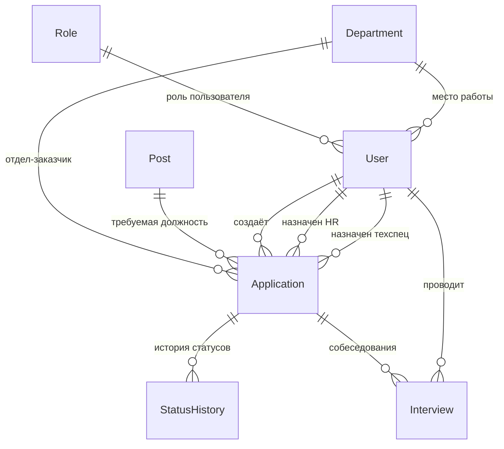

Курс: Б1.В.ДЭ.01.02.02 · КГЭУ · семестр 1 · 2026/2027  
Студент: Карамов Марсель Айратович · Группа: ТРИС-3-23 · Дата: 26.09.2026

# Posts - реестр должностей.

| Поле | Тип          | Ключ | Обязательность | Описание                      |
| ---- | ------------ | ---- | -------------- | ----------------------------- |
| id   | integer      | PK   | да             | Идентификатор                 |
| name | varchar(255) |      | да             | Название должности, уникально |

# Role - справочник ролей.

| Поле | Тип          | Ключ | Обязательность | Описание                   |
| ---- | ------------ | ---- | -------------- | -------------------------- |
| id   | integer      | PK   | да             | Идентификатор              |
| code | enum         |      | да             | Логин                      |
| name | varchar(255) |      | да             | Отображаемое название роли |

enum code = DepartmentHead, HRHead, HRSpecialist, TechSpecialist

# Department - справочник подразделений.

| Поле | Тип          | Ключ | Обязательность | Описание               |
| ---- | ------------ | ---- | -------------- | ---------------------- |
| id   | integer      | PK   | да             | Идентификатор          |
| name | varchar(120) |      | да             | Название подразделения |

# Users - пользователи системы.

| Поле         | Тип          | Ключ | Обязательность | Описание                |
| ------------ | ------------ | ---- | -------------- | ----------------------- |
| id           | integer      | PK   | да             | Идентификатор           |
| login        | varchar(120) |      | да             | Логин                   |
| passwordHash | varchar(255) |      | да             | Хэш пароля              |
| fullName     | varchar(120) |      | да             | Полное имя              |
| roleId       | integer      | FK   | да             | Ссылка на Role.id       |
| departmentId | integer      | FK   | да             | Ссылка на Department.id |

# Application - заявка на прием сотрудника.

| Поле            | Тип          | Ключ | Обязательность | Описание                                                 |
| --------------- | ------------ | ---- | -------------- | -------------------------------------------------------- |
| id              | integer      | PK   | да             | Идентификатор                                            |
| number          | integer      |      | да             | Номер заявки                                             |
| title           | varchar(80)  |      | да             | Заголовок                                                |
| description     | varchar(500) |      | да             | Описание                                                 |
| status          | enum         |      | да             | Статус                                                   |
| postId          | integer      | FK   | да             | Ссылка на Post.id - требуемая должность                  |
| departmentId    | integer      | FK   | да             | Ссылка на Department.id - отдел, который ищет сотрудника |
| createdByUserId | integer      | FK   | да             | Ссылка на User.id — автор записи                         |
| hrId            | integer      | FK   | нет            | Ссылка на User.id — назначенный HR-специалист            |
| techId          | integer      | FK   | нет            | Ссылка на User.id — назначенный технический специалист   |
| createdAt       | timestamp    |      | да             | Дата создания                                            |

enum status = New, InProgress, Closed, Cancelled

# StatusHistory - история смены статусов

| Поле            | Тип       | Ключ | Обязательность | Описание                                    |
| --------------- | --------- | ---- | -------------- | ------------------------------------------- |
| id              | integer   | PK   | да             | Идентификатор                               |
| applicationId   | integer   | FK   | да             | Ссылка на Application.id                    |
| fromStatus      | enum      |      | нет            | Предыдущий статус; null при создании заявки |
| toStatus        | enum      |      | да             | Новый статус                                |
| changedByUserId | integer   | FK   | да             | Ссылка на User.id                           |
| changedAt       | timestamp |      | да             | Время изменения                             |

enum status = New, InProgress, Closed, Cancelled

# Interview - собеседование по заявке

| Поле              | Тип          | Ключ | Обязательность | Описание                                                  |
| ----------------- | ------------ | ---- | -------------- | --------------------------------------------------------- |
| id                | integer      | PK   | да             | Идентификатор                                             |
| applicationId     | integer      | FK   | да             | Ссылка на Application.id                                  |
| interviewerUserId | integer      | FK   | да             | Ссылка на User.id — кто проводил (технический специалист) |
| scheduledAt       | timestamp    |      | нет            | Плановая дата проведения собеседования                    |
| conductedAt       | timestamp    |      | нет            | Фактическая дата и время проведения собеседования         |
| result            | enum         |      | нет            | Результат собеседования                                   |
| comment           | varchar(500) |      | нет            | Комментарий к собеседованию                               |

enum result = Recommended, NotRecommended, null

# ER-диаграмма

# ER-модель

1. Role → User — один-ко-многим (1:N) Одна роль (Role) может быть у многих
   пользователей (User).

Один пользователь имеет ровно одну роль.

Реализация: User.roleId (FK) → Role.id (PK).

Обязательность: roleId обязателен.

2. Department → User — один-ко-многим (1:N) Одно подразделение (Department)
   может быть у многих пользователей.

Один пользователь привязан к одному подразделению.

Реализация: User.departmentId (FK) → Department.id (PK).

3. Department → Application — один-ко-многим (1:N) Одно подразделение
   (Department) может быть заказчиком многих заявок.

У одной заявки одно подразделение-заказчик.

Реализация: Application.departmentId (FK) → Department.id (PK).

Обязательность: departmentId обязателен.

4. Post → Application — один-ко-многим (1:N) Одна должность (Post) может
   встречаться в многих заявках.

У одной заявки одна требуемая должность.

Реализация: Application.postId (FK) → Post.id (PK).

Обязательность: postId обязателен.

5. User → Application (автор) — один-ко-многим (1:N) Один пользователь (User)
   может создать много заявок.

У одной заявки один автор.

Реализация: Application.createdByUserId (FK) → User.id (PK).

Обязательность: createdByUserId обязателен.

Кто: руководитель подразделения.

6. User → Application (HR-специалист) — один-ко-многим (1:N), необязательная
   Один пользователь с ролью HR-специалист может быть назначен на много заявок.

У одной заявки не более одного назначенного HR.

Реализация: Application.hrId (FK) → User.id (PK).

Обязательность: hrId необязателен (null, пока не назначен).

7. User → Application (технический специалист) — один-ко-многим (1:N),
   необязательная Один технический специалист может быть назначен на много
   заявок.

У одной заявки не более одного назначенного техспеца.

Реализация: Application.techId (FK) → User.id (PK).

Обязательность: techId необязателен (null, пока не назначен).

Связи 5, 6, 7 — это три разные роли одного User по отношению к заявке. Поэтому
три отдельных FK на одну и ту же таблицу User.

8. Application → StatusHistory — один-ко-многим (1:N) У одной заявки
   (Application) много записей истории статусов.

Одна запись истории принадлежит одной заявке.

Реализация: StatusHistory.applicationId (FK) → Application.id (PK).

Обязательность: applicationId обязателен.

Смысл: каждая смена статуса — новая строка, история не теряется.

9. User → StatusHistory — один-ко-многим (1:N) Один пользователь (User) может
   изменить статус много раз (у многих заявок).

У одной записи истории один автор изменения.

Реализация: StatusHistory.changedByUserId (FK) → User.id (PK).

Обязательность: changedByUserId обязателен.

10. Application → Interview — один-ко-многим (1:N) У одной заявки (Application)
    может быть несколько собеседований (повторные, разные специалисты).

Одно собеседование принадлежит одной заявке.

Реализация: Interview.applicationId (FK) → Application.id (PK).

Обязательность: applicationId обязателен.

11. User → Interview — один-ко-многим (1:N) Один пользователь (технический
    специалист) может провести много собеседований.

У одного собеседования один проводящий.

Реализация: Interview.interviewerUserId (FK) → User.id (PK).

Обязательность: interviewerUserId обязателен.

# Проверка ЗНФ

Названия справочников хранятся каждый в своей сущности один раз: должность — в
Post, подразделение — в Department, роль — в Role. Заявка Application содержит
внешние ключи postId и departmentId, а пользователь User — roleId и
departmentId. Тексты названий в этих таблицах не дублируются. При переименовании
должности, подразделения или роли меняется одна строка в соответствующем
справочнике, и это автоматически отражается во всех связанных записях.
